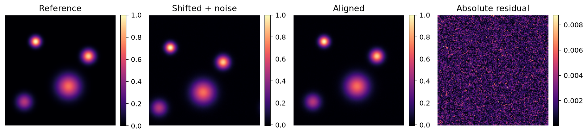

# Image registration — OptiIA Consulting

Align translated images with phase correlation and quantify the residual.

An executable project example using generated data. Images and graphs below are generated by the included code.



## Run

Python 3.12 recommended:
```bash
python -m pip install -r requirements.txt
python -m unittest -v test_analysis
python analysis.py --seed 42 --out results
```

The script writes plots, a data export and JSON metrics to `results/`. The committed `metrics.json` and `preview.png` correspond to seed 42. Import the functions in `analysis.py` to process your own compatible arrays.

## Method

Normalize the Fourier cross-power spectrum, locate its inverse-FFT maximum and convert wrapped indices to signed integer shifts. Apply that corrective shift and compare the aligned image with the reference. The example uses a generated microscopy-like image with independent noise.

## Assumptions and limitations

Integer translations only and periodic boundaries (np.roll). No subpixel accuracy, rotation, scaling, cropping or occlusion handling. Large real images need a windowed/nonperiodic approach and a confidence check. Synthetic spots are illustrative, not patient images.

Synthetic results establish reproducibility of this example, not performance on real instruments. No proprietary source code, data or photographs are included.

## Validation

Four tests exercise exact reference cases, independent data or noise realizations, and input validation. See `test_analysis.py` for thresholds and checks.

## Related activities

Scientific computing, instrumentation data analysis, image processing and Python automation.

[More project examples](https://github.com/yaghi-ali) · [OptiIA Consulting](https://www.optiia-consulting.fr) · contact@optiia-consulting.fr
